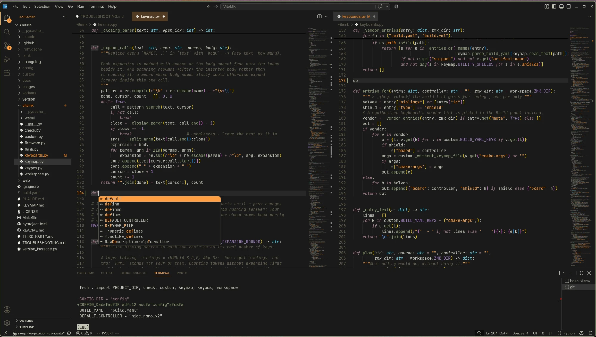
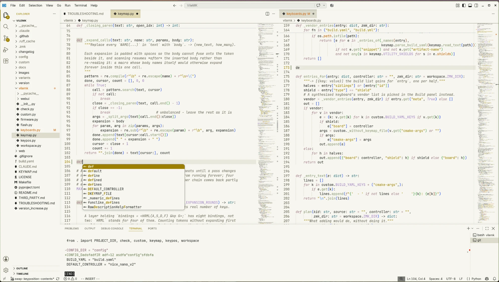

# Evening in Kyoto


*Photo: Patricia Stanca, used with her permission.*

A VS Code colour theme calibrated for protanomaly. It comes in two variants: Evening in Kyoto is
dark and Morning in Kyoto is light. This is the VS Code version of
[evening-in-kyoto-nvim](https://github.com/cosminoance/evening-in-kyoto-nvim), which describes
where the colours come from.

## Screenshots

Evening in Kyoto, with Kyoto Icons: two editor groups, the autocomplete list and a diff in the
terminal.



Morning in Kyoto, the same view:



## Disclaimer

The colours are chosen by how they look to me, since I see red at about 30% of the saturation a
typical vision would see.

For example, someone with this particularity would not distinguish bright green from yellow, or
brown from dark green... or light pink from gray.

The colours were chosen to stay apart for that vision, not for how they look to typical eyes.

## Install

Search for "Evening in Kyoto" in the Extensions view and install it. Then:

- pick Evening in Kyoto or Morning in Kyoto from "Preferences: Color Theme"
- pick Kyoto Icons from "Preferences: File Icon Theme"

Kyoto Icons are [Seti UI](https://github.com/jesseweed/seti-ui)'s file icons (MIT, the default
in VS Code), recoloured and not redrawn, all in the palette's
off-white (`#f6f6ef`; in Morning, the near-black text colour). Seti's blue, cyan and violet icons clash with
the amber of the active tab for protanomaly. VS Code has no setting for icon colours, so the
recoloured icons are a separate theme in the same extension.

## Which element gets which colour

The same as in Neovim:

- strings and headings: yellow (light amber in Evening, dark gold in Morning)
- functions and inline code: green (sage)
- keywords, `self`/`this`, list markers: red (dusty rose), keywords in italic
- types: cyan, italic
- numbers and constants: magenta (soft violet)
- decorators and attributes: orange, italic
- links: blue
- comments: olive grey, italic

## Differences from the Neovim theme

- No transparent background. VS Code has no transparent window.
- Search matches are translucent. Neovim recolours the text inside a match; VS Code keeps the
  syntax colour, so a solid yellow background would hide it.
- The current-line highlight is at half strength, so a selection on that line stays visible.
- Diffs tint the background instead of colouring the text.

## Licence

MIT, see `LICENSE`. The names "Evening in Kyoto" and "Morning in Kyoto" and the extension icon
are not part of that grant. Neither is the photo at the top, which belongs to Patricia Stanca.
Forks and derived themes are welcome under their own names.

## Building

The theme files in `themes/` and `icons/kyoto-icon-theme.json` are generated from
`palette.json` by `build.mjs`. The icons' licences are in `icons/LICENSE.md`. After changing
a colour:

```bash
npm run build
```
